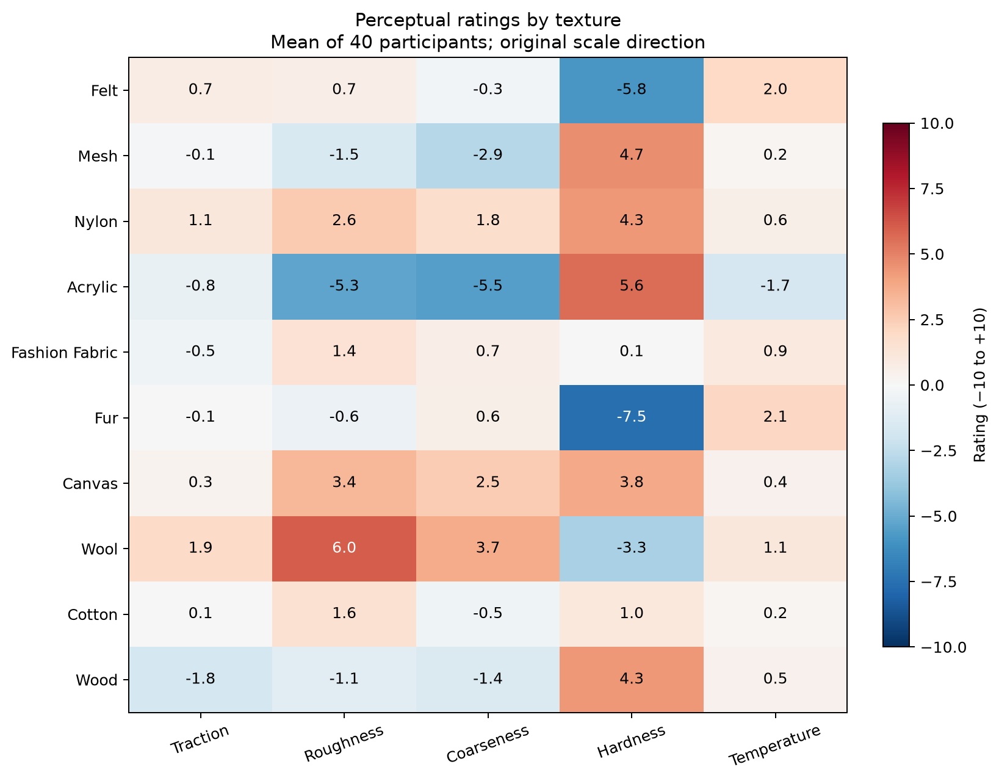

# Human Strategies for Single Finger Texture Exploration

[](https://github.com/aoli0919/Human-Texture-Exploration-Experiment/actions/workflows/reproduce.yml)

Data and software for studying how people perceive ten textures and vary their single-finger exploration. The supplied workbooks contain 40 participant columns, 2,000 perceptual ratings, and 400 reported force/speed pairs.

The analysis runs without a camera, force sensor, or downloaded videos. It reproduces summaries and explicitly defined analyses of the processed data. The original raw-force preprocessing and video-to-speed extraction are not supplied, so this does not establish a reproduction of those pipelines or of a paper's results.



The figure is generated by the analysis below. Each cell averages 40 participant ratings; coarseness retains the source direction (−10 fine, +10 coarse).

## Get the repository

For analysis, use a partial clone excluding the large video directory (Git 2.37 or later):

```bash
git clone --filter=blob:none --sparse https://github.com/aoli0919/Human-Texture-Exploration-Experiment.git
cd Human-Texture-Exploration-Experiment
git sparse-checkout set --no-cone '/*' '!/data/raw/video/'
```

This includes both workbooks and all 400 raw-force CSVs. A full clone also downloads the videos and can be substantially larger. Run `git sparse-checkout disable` to materialize omitted files later.

## Run the analysis

Use Python 3.11 or later. From the repository root:

```bash
python3 -m venv .venv
source .venv/bin/activate
python -m pip install -e .
python -m human_texture verify --data-dir data
python -m human_texture reproduce --data-dir data --output-dir outputs/reproduction
```

On Windows PowerShell, activate with `.venv\Scripts\Activate.ps1`. The default run checks the 400 referenced raw-force files as well as the workbooks. For a copy containing only `data/processed/`, use:

```bash
python -m human_texture reproduce --data-dir data --output-dir outputs/reproduction --skip-raw
```

Open `outputs/reproduction/report.md` for results and `audit.json` for validation details. Generated files include:

| Output | Contents |
| --- | --- |
| `observations.csv` | 400 participant–texture observations with source-file references |
| `rating_summary.csv` | Statistics for each texture and perceptual dimension |
| `exploration_summary.csv` | Statistics for supplied force and speed values |
| `within_participant_correlations.csv` | Spearman correlations across ten textures within each participant |
| `association_summary.csv` | Summary of participant-level correlation distributions |
| `raw_force_qc.csv` | Raw-force checks when raw checking is enabled |
| `figures/` | PNG and SVG ratings, force/speed distributions, and association figures |

Rerunning replaces generated files in this output directory. A nonempty directory created outside this tool is rejected to protect existing work. To run the regression tests, use `python -m unittest discover -s tests`.

CI runs the tests and the complete analysis on Linux with Python 3.11 and 3.12, and uploads the results under each workflow run's **Artifacts** section. The supplied dataset passes 25 regression tests and full validation of 400 observations, 2,000 matched ratings, and 48,246 raw-force samples. Hardware operation is not part of these checks.

Correlations treat participants as repeated-measurement units and report their rho distributions. They do not treat all 400 observations as independent subjects or claim a paper's regression results. See [methods](docs/methods.md) and the [data dictionary](docs/data_dictionary.md).

## Data and layout

```text
data/processed/       Original Excel workbooks
data/raw/force/       400 CSVs in 40 session folders
data/raw/video/       400 MP4s; optional for this analysis
data/raw/questionnaire/ Original export; not used by the analysis
src/human_texture/    Hardware-free analysis package
acquisition/          Configurable collection CLI
legacy/acquisition/   Original collection scripts
docs/                 Methods, data dictionary, acquisition guide, original PDFs
outputs/              Generated analysis and acquisition results
```

Original data and workbooks are preserved byte-for-byte; generated tables are separate. Ratings span −10 to +10 for traction, roughness, coarseness, hardness, and temperature sensation. The source calls the coarseness question **Fineness**, but its positive endpoint means **coarse**; the analysis preserves this sign.

For links to the old directory names, see the [path migration table](docs/reorganization.md).

Reported force/speed units are not declared in the workbooks. The author confirms that speed processing used pixel-to-millimetre spatial calibration, but the coefficient and calibration files are no longer available; the final speed time unit is unconfirmed. Outputs preserve reported values with unspecified units. Workbook `NF` and `SS` are extracted/rounded values, not evidence of normalization.

## Collect new data

Inspect a seeded trial plan without hardware dependencies or device access:

```bash
python -m acquisition --dry-run --seed 42
```

For a RobotiQ FT300-S sensor and compatible camera:

```bash
python -m pip install -e '.[acquisition]'
python -m acquisition --session-id pilot001 --output-dir outputs/acquisition --serial-port /dev/ttyUSB0 --camera-index 0 --seed 42
```

See the [acquisition guide](docs/acquisition.md) for controls and timing. Dry-run and software tests do not establish physical hardware operation.

## Related work

These publications provide research context; their presence does not establish that this dataset reproduces their experiments or reported results.

- [Velocity Modulation in Robotic Texture Exploration Based on Human Perceptual Dimensions](https://doi.org/10.1109/HUMANOIDS65713.2025.11203031), Humanoids 2025.
- [Exploratory Movement Strategies for Texture Discrimination with a Neuromorphic Tactile Sensor](https://arxiv.org/abs/2509.14954), IROS 2025.
- [Neuromorphic touch for robotics—a review](https://doi.org/10.1088/2634-4386/adf091), Neuromorphic Computing and Engineering, 2025.

## Citation and contact

See [CITATION.cff](CITATION.cff) for repository citation metadata. Dataset questions: [Ao Li](mailto:ao.li@bristol.ac.uk) or [Benjamin Ward-Cherrier](mailto:b.ward-cherrier@bristol.ac.uk).
